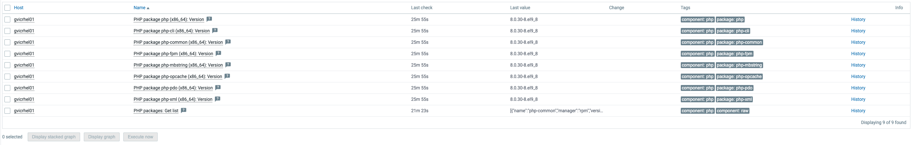

# PHP package discovery by ATS

A Zabbix 7.0 template that finds every PHP package installed on a Linux host, records its version, and checks it against **PHP2Shell** (CVE-2026-109618 and CVE-2026-109619).

| | |
|---|---|
| **Vendor** | ATS |
| **Version** | 7.0-0 |
| **Zabbix** | 7.0 and newer |
| **Template group** | Templates/Operating systems |
| **Collection** | Zabbix agent / agent 2 (passive or active), `system.sw.packages.get` |

---

## About PHP2Shell

On 21 October 2026 the PHP project released fixes for two critical vulnerabilities that together are known as **PHP2Shell**.

| CVE | Summary |
|---|---|
| **CVE-2026-109618** | Remote code execution through out-of-memory handling. An out-of-memory error can interrupt PHP while request data is only partly set up, and the cleanup code then treats that data as valid. |
| **CVE-2026-109619** | Remote code execution through leftover global state. Internal state that belongs to one request can outlive the memory it points to, and a later request on the same worker can use it before it is reset. |

- **Severity:** CVSS 4.0 score 9.2 (Unit 42).
- **Attack:** remote, needs no login, and works with a single request before any application code runs.
- **Exploit:** a working exploit has been demonstrated. Proof-of-concept code exists.
- **Affected setups:** every PHP install that serves web requests, including PHP-FPM, Apache with mod_php, php-cgi, FrankenPHP and LiteSpeed. **mod_php carries the highest risk.**

### Fixed versions

| Branch | Fixed in | Status |
|---|---|---|
| 8.5 | **8.5.12** | Supported |
| 8.4 | **8.4.27** | Supported |
| 8.3 | **8.3.36** | Supported |
| 8.2 | **8.2.35** | Supported until 31 Dec 2026 |
| 8.1 and older | No upstream release | End of life. Only source backports (7.4, 8.0, 8.1) or vendor/LTS packages are available. |

Linux distributions and LTS vendors received the patches ahead of the public release. **Check your vendor for updated packages.** The Remi repository (rpms.remirepo.net) did not have updates on release day.

---

## What the template does

```
system.sw.packages.get["^php"]          (master item, every {$PHP.PKG.INTERVAL})
 ├── PHP package discovery              (every php* package)
 │    └── <pkg>: Version                + "version has changed" trigger (Info)
 └── PHP2Shell exposure discovery       (core "-common" package only)
      └── <pkg>: Installed version
           └── <pkg>: Exposure status   (JavaScript compares the version to the fixed releases)
                ├── Trigger: Vulnerable to PHP2Shell        (High)
                └── Trigger: End-of-life branch, likely vulnerable (High)
```

The agent makes one call per interval. Everything else is a dependent item, so the template adds almost no load.

### Example

Discovered PHP packages on a RHEL 9 host (**Monitoring → Latest data**):



This host runs the RHEL 9 AppStream PHP 8.0 build (`8.0.30-8.el9_8`). PHP 8.0 is an end-of-life branch, so the PHP2Shell check reports it as **End-of-life branch** and raises the matching trigger. If Red Hat ships a backported fix, add the patched version to `{$PHP2SHELL.PATCHED.RELEASES}` (see [Distribution backports and false positives](#distribution-backports-and-false-positives)).

### Why it checks only the "-common" package

Every distribution's PHP install has a `-common` package built from the same source as the SAPI packages (cli, fpm, mod_php). Checking only that package:

- raises **one problem per PHP install**, not one per package;
- leaves out **PECL extensions, PEAR and PHP libraries** such as `php-pecl-apcu` and `php-symfony-*`, whose own version numbers would trigger false alarms.

| Distribution | Package checked |
|---|---|
| RHEL / Rocky / Alma / Fedora | `php-common` |
| Debian / Ubuntu | `php8.x-common` |
| Remi SCL | `phpXX-php-common` |
| Alpine | `phpXX-common` |

---

## Installation

1. In Zabbix go to **Data collection → Templates → Import** and import `PHP_Package_Discovery_by_ATS.yaml`.
2. Link **PHP package discovery by ATS** to your Linux hosts, or to the template or host group that covers them.
3. The first results appear after one interval (1h by default). To get results right away, open the **PHP packages: Get list** item on a host and click **Execute now**.

**Requirements**

- Zabbix server/proxy 7.0 or newer.
- Zabbix agent or agent 2 on the host, able to run `system.sw.packages.get`. It supports rpm, dpkg, pacman and similar package managers.
- PHP installed from packages. PHP built from source does not appear in the package list, so this template can't see it.

---

## Macros

| Macro | Default | Description |
|---|---|---|
| `{$PHP.PKG.INTERVAL}` | `1h` | How often the agent collects the package list. |
| `{$PHP.PKG.MATCHES}` | `^php` | Regex for the package names the agent returns. |
| `{$PHP2SHELL.FIXED.VERSIONS}` | `8.2.35,8.3.36,8.4.27,8.5.12` | Upstream fixed release for each supported branch. Any branch older than the oldest one listed counts as end of life. |
| `{$PHP2SHELL.PATCHED.RELEASES}` | *(empty)* | Comma-separated **exact** package versions that your vendor has confirmed as patched by a backport. |
| `{$PHP2SHELL.PKG.MATCHES}` | `^(php[0-9.]*\|php[0-9]+-php)-common$` | Regex for the packages checked for PHP2Shell. |

All macros can be overridden at host or template level in the usual way.

---

## Items

| Item | Key | Type |
|---|---|---|
| PHP packages: Get list | `system.sw.packages.get["{$PHP.PKG.MATCHES}"]` | Zabbix agent (Text) |
| PHP package *pkg* (*arch*): Version | `php.package.version[pkg,arch]` | Dependent (Character) |
| PHP2Shell: *pkg* (*arch*): Installed version | `php.php2shell.version[pkg,arch]` | Dependent (Character) |
| PHP2Shell: *pkg* (*arch*): Exposure status | `php.php2shell.status[pkg,arch]` | Dependent (Numeric, value map) |

### Exposure status values

| Value | Meaning |
|---|---|
| `0` – Not affected | At or above the fix for its branch, newer than any affected branch, or listed in `{$PHP2SHELL.PATCHED.RELEASES}`. |
| `1` – Vulnerable | Supported branch, but below the upstream fix. |
| `2` – End-of-life branch | PHP 8.1 or older. There is no upstream fix, so it is vulnerable unless your vendor backported one. |
| `3` – Unknown | The version string could not be read, for example a Debian metapackage version such as `2:93`. |

The script removes package epochs (`1:8.4.30-1`) and reads the upstream `x.y.z` from the start of the version string, so it works with RPM, DEB and APK version formats.

---

## Triggers

| Name | Severity | Fires when |
|---|---|---|
| PHP *pkg*: Vulnerable to PHP2Shell (CVE-2026-109618, CVE-2026-109619) | High | Status = 1 |
| PHP *pkg*: End-of-life branch, likely vulnerable to PHP2Shell | High | Status = 2 |
| PHP package *pkg* version has changed | Info | The package version changed |

The PHP2Shell triggers:

- show the installed version as operational data;
- link to the PHP security advisory;
- are tagged `cve:CVE-2026-109618`, `cve:CVE-2026-109619` and `scope:security`;
- clear on their own once the package is updated (they can also be closed manually).

> **Tip:** Because a public exploit exists for this remote code execution, which needs no login, you may want to raise the "Vulnerable" trigger to **Disaster**.

To build a dashboard or report of exposed hosts, filter **Monitoring → Problems** on the tag `cve` = `CVE-2026-109618`.

---

## Distribution backports and false positives

**Read this before rolling out the template.**

The check compares the **upstream** PHP version only. Enterprise distributions such as Red Hat, Debian, Ubuntu and SUSE often fix a vulnerability by **patching their own package without changing the upstream version**. For example, a fully patched RHEL package can still read `8.2.13-…`. Those hosts will show as vulnerable even though they are not.

To clear them:

1. Check your vendor's security advisory (RHSA, DSA, USN and so on) for the fixed package version.
2. Copy the exact value from the host's **PHP2Shell: … Installed version** item.
3. Add it to `{$PHP2SHELL.PATCHED.RELEASES}`, separating entries with commas:

   ```
   8.2.13-1.el9_6.2,8.3.6-0ubuntu0.24.04.7
   ```

4. The status changes to **Not affected** on the next collection and the problem resolves.

Set the macro at template level to cover the whole environment, or at host level for exceptions.

---

## If you can't update right away

The PHP project lists interim mitigations. These **reduce exposure but do not make an install safe**. Only updating fixes the problem.

```ini
; php.ini (applies before request parsing; restart all workers afterwards)
memory_limit = -1                    ; CVE-2026-109618
post_max_size = 8M                   ; or 32M if uploads are needed
upload_max_filesize = 8M             ; keep below post_max_size
session.upload_progress.enabled = 0  ; CVE-2026-109619
fatal_error_backtraces = 0           ; PHP 8.5 only
```

```ini
; PHP-FPM pool: stop applications overriding memory_limit
php_admin_value[memory_limit] = -1
```

- Don't use `RLIMIT_AS` or `RLIMIT_DATA` instead of `memory_limit`. They can trigger the vulnerable allocation failure.
- Don't rely on `ini_set()` or `.user.ini` for these settings.
- Limit request size, field count, multipart parts, header count and nesting depth at the web server or proxy.
- The UK NCSC recommends taking systems offline if they can't be fixed right away.

---

## Updating for future fixes

If PHP releases another fix for these CVEs, update `{$PHP2SHELL.FIXED.VERSIONS}`. You don't need to change the template itself.

---

## Changelog

**7.0-0**

- First release: PHP package discovery with version-change notification.
- Added PHP2Shell (CVE-2026-109618, CVE-2026-109619) exposure discovery, status item and triggers.
- Added the `{$PHP.PKG.INTERVAL}` macro (default `1h`), which was referenced but not defined.

---

## References

- [PHP security advisory, 21 Oct 2026](https://www.php.net/archive/2026.php#2026-10-21-5)
- [Unit 42: CVE-2026-109618 and CVE-2026-109619](https://unit42.paloaltonetworks.com/cve-2026-109618-cve-2026-109619/)
- [Help Net Security: PHP2Shell vulnerabilities patched](https://www.helpnetsecurity.com/2026/10/21/php2shell-php-vulnerabilities-patched-cve-2026-109618-cve-2026-109619/)
